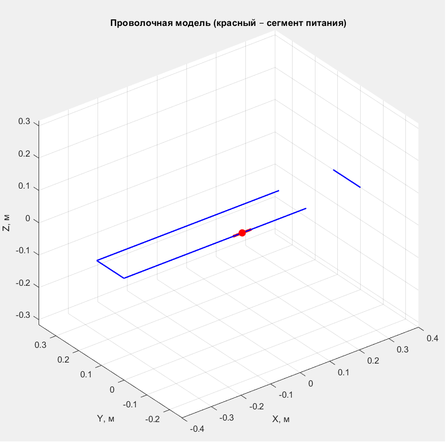
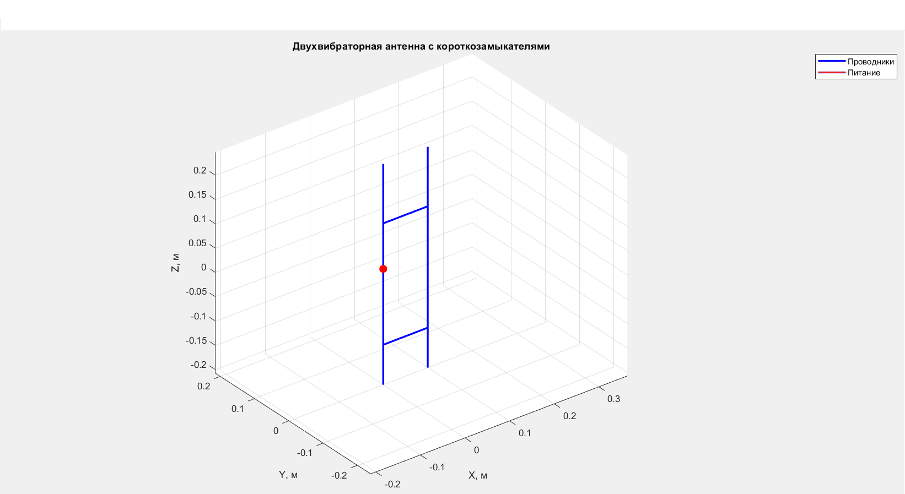
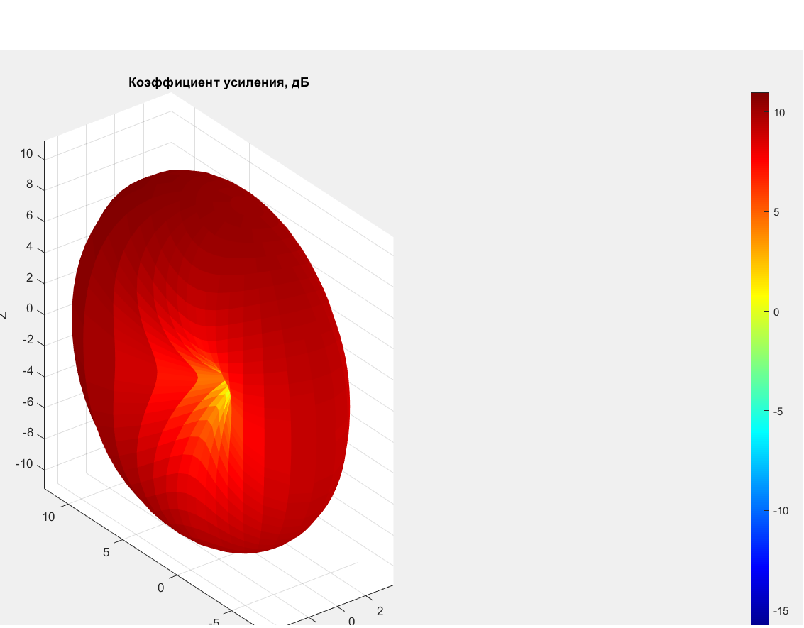
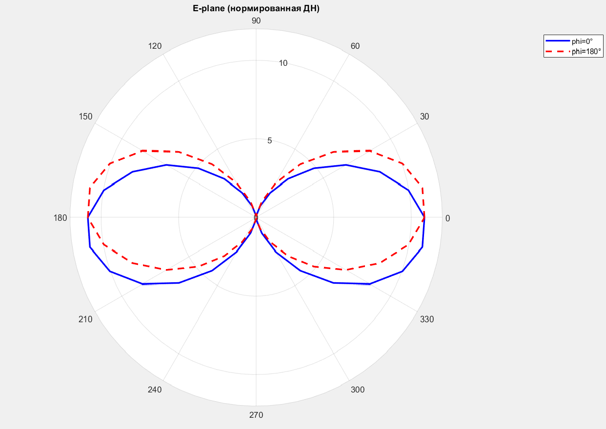
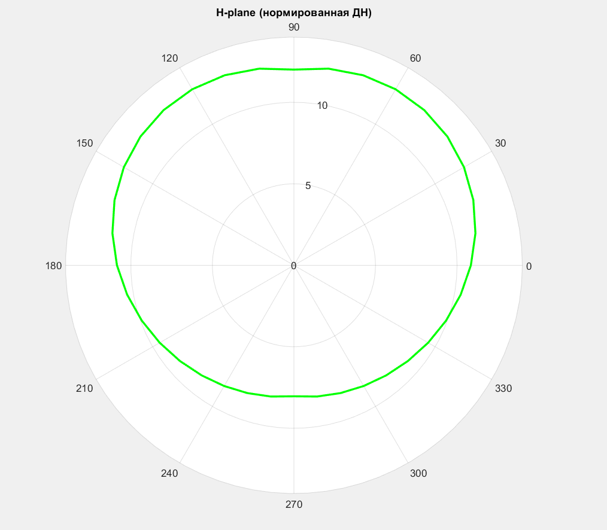
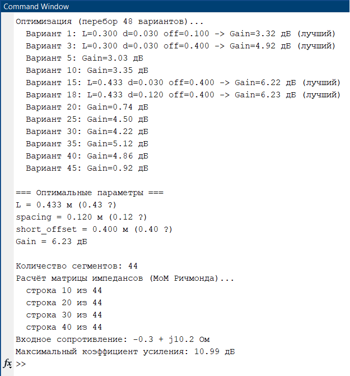
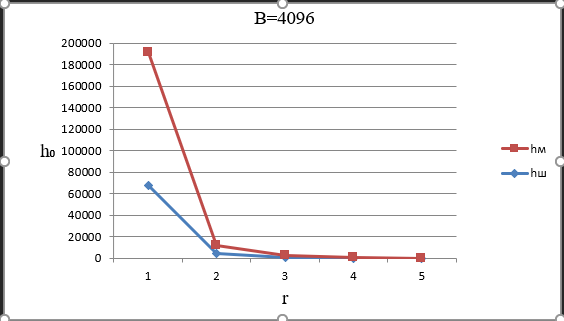
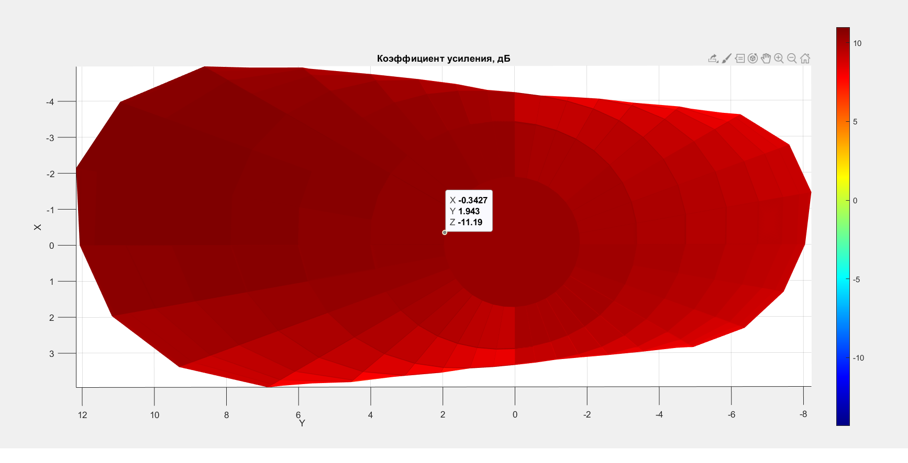

# Broadband Antenna Optimization (MATLAB)

Математическое моделирование и оптимизация широкополосной вибраторной антенны методом моментов (метод Ричмонда).

---

## 📖 Описание проекта

Проект посвящён **математическому моделированию и оптимизации** широкополосной симметричной вибраторной антенны для радиоканалов УКВ-диапазона.

В работе реализован **метод моментов (MoM)** в формулировке Ричмонда — эффективный численный метод для анализа тонкопроволочных антенн. Проведён расчёт распределения тока по проводникам, построены диаграммы направленности и выполнена оптимизация геометрии антенны по коэффициенту усиления.

---

## 🚀 Возможности

- **Расчёт распределения тока** по проводникам антенны методом Ричмонда.
- **Построение диаграммы направленности** (E-plane, H-plane, 3D).
- **Оптимизация геометрии** антенны по коэффициенту усиления (перебор параметров).
- **Моделирование радиоканала УКВ-диапазона**: расчёт отношения сигнал/шум на входе демодулятора для разных дальностей, баз сигнала и типов приёмных антенн.
- **Визуализация** результатов: 3D-ДН, полярные диаграммы, графики зависимостей.

---

## 🛠️ Технологии

- **MATLAB R2019b** — среда разработки и расчётов.
- **Метод моментов (MoM)** — численный метод решения интегральных уравнений электродинамики.
- **Метод Ричмонда** — реализация MoM для тонкопроволочных антенн с кусочно-синусоидальным базисом.
- **Квадратуры Гаусса-Лежандра** — численное интегрирование.
- **Матричные вычисления** — решение СЛАУ для нахождения токов.

---

## 📊 Результаты

### Оптимизация геометрии антенны

В ходе перебора 48 вариантов геометрии найдены оптимальные параметры:

| Параметр | Значение | Относительно λ |
|---|---|---|
| Длина вибратора (L) | 0.433 м | 0.43λ |
| Расстояние между вибраторами (d) | 0.120 м | 0.12λ |
| Смещение короткозамыкателей (offset) | 0.400 м | 0.40λ |
| **Коэффициент усиления** | **10.99 дБ** | — |

**Исходное усиление:** ~3 дБ.  
**После оптимизации:** 10.99 дБ.  
**Выигрыш:** более чем в 7 раз по линейной мощности.

### Моделирование радиоканала

- Сравнение **штыревой** и **магнитной** приёмных антенн.
- **Магнитная антенна** даёт выигрыш по отношению сигнал/шум в **1.8–2.0 раза**.
- Рассчитаны зависимости сигнал/шум от дальности связи (до 50 км) и базы сигнала (255–4096).

---

## 📁 Структура репозитория
broadband-antenna-optimization/
├── README.md
├── LICENSE
├── src/
│ ├── richmond_method.m
│ └── optimization.m
└── screenshots/
├── 01_antenna_geometry.png
├── 02_antenna_geometry_opt.png
├── 03_3d_pattern.png
├── 04_e_plane.png
├── 05_h_plane.png
├── 06_optimization_result.png
├── 07_snr_graph.png
└── 08_antenna_3d_side.png

---

## 📸 Скриншоты

### 1. Геометрия антенны (исходная)

### 2. Геометрия антенны (после оптимизации)

### 3. 3D-диаграмма направленности

### 4. E-plane (вертикальное сечение)

### 5. H-plane (горизонтальное сечение)

### 6. Результат оптимизации

### 7. График сигнал/шум

### 8. 3D-ДН (вид сбоку)

---

## 🚀 Запуск

1. Установить **MATLAB R2019b** или новее.
2. Склонировать репозиторий:
git clone https://github.com/VS-prog10/broadband-antenna-optimization.git
3. Открыть MATLAB и перейти в папку `src/`.
4. Запустить **`richmond_method.m`** — расчёт параметров.
5. Запустить **`optimization.m`** — оптимизация геометрии.

---

## 📄 Лицензия

Проект под лицензией **MIT** — см. файл [LICENSE](LICENSE).

---

## 👤 Автор

**Владислав Сергеевич**  
GitHub: [@VS-prog10](https://github.com/VS-prog10)

---

⭐ Если проект интересен — поставь звезду!
